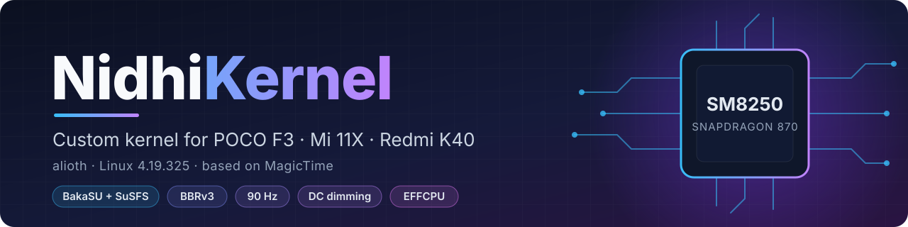

<p align="center">
  
</p>

# NidhiKernel

A custom kernel for **alioth** (POCO F3 / Mi 11X / Redmi K40, Snapdragon 870),
based on Linux 4.19.325 (CIP). It is a fork of TIMISONG-dev's
[MagicTime](https://github.com/TIMISONG-dev/kernel_xiaomi_sm8250) kernel.

| Branch | For |
|---|---|
| `nidhi` | AOSP-based ROMs (built on `magictime-new`) |
| `nidhi-miui` | MIUI / HyperOS (`magictime-miui` with `nidhi` merged in) |

> **Only alioth is officially supported and tested.** The build workflow
> can also produce apollo (Mi 10T / Redmi K30S) and pipa (Xiaomi Pad 6)
> kernels from the same source, but those builds may fail to compile or
> may not boot. Keep your stock boot images before trying one.

## Features

Everything below is on by default. Each feature has its own `CONFIG_` switch
in `arch/arm64/configs/vendor/xiaomi/magictime-common.config`. Only the
all-on combination is tested.

### Root and hiding
| Feature | Switch |
|---|---|
| [BakaSU](https://github.com/Baka-SU/BakaSU) (KernelSU) | `CONFIG_KSU` |
| SuSFS v2.3.0 with the priority UID filter | `CONFIG_KSU_SUSFS` |
| [NoMount](https://github.com/maxsteeel/nomount) VFS path redirection | `CONFIG_NOMOUNT` |
| [Baseband-guard](https://github.com/vc-teahouse/Baseband-guard): blocks writes to critical partitions | `CONFIG_BBG` |
| Ptrace fix: `PTRACE_GETEVENTMSG` no longer leaks stale PIDs (such as zygote's) | — |
| Unicode fix: invisible characters no longer alias names in casefolded folders | — |
| SELinux hide checks the stock and live policies in one pass, so timing gives nothing away (upstream KernelSU fix) | — |

### Performance and battery
| Feature | Switch |
|---|---|
| EFFCPU: e404's efficient CPU tables (prime 2.55 GHz, gold 2.25, silver 1.71) | `CONFIG_EFFCPU` |
| EFFGPU: GPU capped at 587 MHz | `CONFIG_EFFGPU` |
| CASS keeps work off the prime core and breaks ties fairly | — |
| kcompressd: zram compression moved off kswapd | `CONFIG_KCOMPRESSD` |
| NEON LZ4 decoder for zram | `CONFIG_LZ4_ARM64_NEON` |
| BBRv3 TCP congestion control with the fq qdisc | `CONFIG_TCP_CONG_BBR` |
| Built with `-march=armv8.2-a -mtune=cortex-a77` | `CONFIG_ARM64_TUNE_SM8250` |
| ThinLTO with a link cache and a larger import limit | — |
| Quieter suspend and audio logging, dnotify off by default | — |

### Display
| Feature | Switch |
|---|---|
| 90 Hz mode next to 60 and 120 Hz | `CONFIG_K11A_PANEL_90HZ` |
| DC dimming (XiaomiParts' DC Dimming toggle) | `CONFIG_DRM_SDE_EXPO` |
| Minimum backlight: `msm_drm.backlight_min` | `CONFIG_DRM_MSM_BACKLIGHT_MIN` |

### Other
| Feature | Switch |
|---|---|
| [Re:Kernel](https://github.com/Sakion-Team/Re-Kernel) freezer events | `CONFIG_REKERNEL` |
| [Droidspaces](https://github.com/ravindu644/Droidspaces-OSS) container support | `CONFIG_DROIDSPACES` |
| Boeffla wakelock blocker, empty list by default | `CONFIG_BOEFFLA_WL_BLOCKER` |
| NTSync for Wine; `/dev/ntsync` can be opened by apps | `CONFIG_NTSYNC` |
| Networking extras: ipset, TTL/HL targets, tc connmark, CIFS (SMB2/3) | CI switch `net_extras` |

Inherited from MagicTime: KCAL, HBM, USB fast charge, WireGuard and more.

## Building with GitHub Actions

Open **Actions → Build NidhiKernel → Run workflow**:

- **Use workflow from:** `nidhi` for AOSP ROMs, `nidhi-miui` for MIUI.
- **Device:** alioth (supported), apollo or pipa (unsupported).
- **Kernel name:** what `uname -r` shows after the version, NidhiKernel by
  default. Letters, digits and `. _ + -` only.
- **Feature switches:** one checkbox per feature in the tables above, all
  on by default. Turning off KernelSU also turns off SuSFS.

The flashable zip is attached to the run as an artifact. The run summary
lists the kernel release and which features were turned off.

## Releases

**Actions → Release NidhiKernel** builds alioth with every feature on from
the tips of `nidhi` and/or `nidhi-miui` and publishes a release. It takes
the version (such as `3.1`, which becomes the tag; MIUI builds also get
`3.1-miui`) and what to build: Both, AOSP or MIUI. The notes are generated
by `.github/release-notes.py`. They list the commits since the previous
release, the BakaSU driver version and the flashing steps.

## Building locally

```bash
git clone --recurse-submodules -b nidhi https://github.com/kaixenberg/kernel_xiaomi_sm8250
cd kernel_xiaomi_sm8250
CLANG_DIR=/path/to/clang ./build.sh
```

`build.sh` is what the workflow runs: it configures, builds and packages
the flashable zip into `out/`. Use a recent Clang (releases use
[Lilium Clang 22](https://github.com/liliumproject/clang/releases/tag/20250912)),
either in `PATH` or through `CLANG_DIR`. It is set with environment
variables:

| Variable | Default | What it does |
|---|---|---|
| `DEVICE` | `alioth` | `alioth`, `apollo` or `pipa` |
| `KERNEL_NAME` | `NidhiKernel` | Name in `uname -r` after the version |
| `DISABLE` | none | Switches to turn off, such as `"BBG NTSYNC"`. Use the switch names from the feature tables without `CONFIG_`, or `NET_EXTRAS` |
| `VARIANT` | from the branch | `aosp` or `miui`, for the zip name |
| `OUT` | `out` | Build directory |
| `PODMAN_IMAGE` | none | Run the build inside this podman image |

`./build.sh --no-package` stops after the build, and
`./build.sh -- <targets>` configures and then runs only those make targets.
Switches are applied as part of the defconfig merge, so turning one off also
turns off everything it would have selected.

## Packaging and flashing

`build.sh` packages the kernel with the `AnyKernel3` submodule
([NidhiKernel-AnyKernel3](https://github.com/kaixenberg/NidhiKernel-AnyKernel3)).
Flash the zip from recovery. It writes `boot` and `dtbo` on the active slot
and leaves `vendor_boot` alone.

Keep your ROM's `boot`, `vendor_boot` and `dtbo` images: flashing them
with fastboot restores the stock kernel.

## Credits

- TIMISONG-dev for MagicTime, which this kernel is based on.
- kvsnr113 and contributors for [e404](https://github.com/kvsnr113/xiaomi_sm8250_kernel_e404),
  the source of EFFCPU, the CASS changes, the NEON LZ4 decoder, kcompressd
  and the DC dimming driver.
- The BakaSU, SuSFS, NoMount, Baseband-guard, Re:Kernel and Droidspaces
  projects, and the authors of the BBRv3 backport. BakaSU comes from the
  [kaixenberg/BakaSU](https://github.com/kaixenberg/BakaSU) fork, which adds
  upstream KernelSU fixes BakaSU does not have yet.
- WildKernels' [kernel_patches](https://github.com/WildKernels/kernel_patches),
  for the ptrace, Unicode, NTSync and networking ideas.
- LowTension's [BAALAM](https://github.com/LowTension/BAALAM_android_kernel_xiaomi_sm8250) kernel, for the 90 Hz mode and the Boeffla and
  backlight-min ideas.
